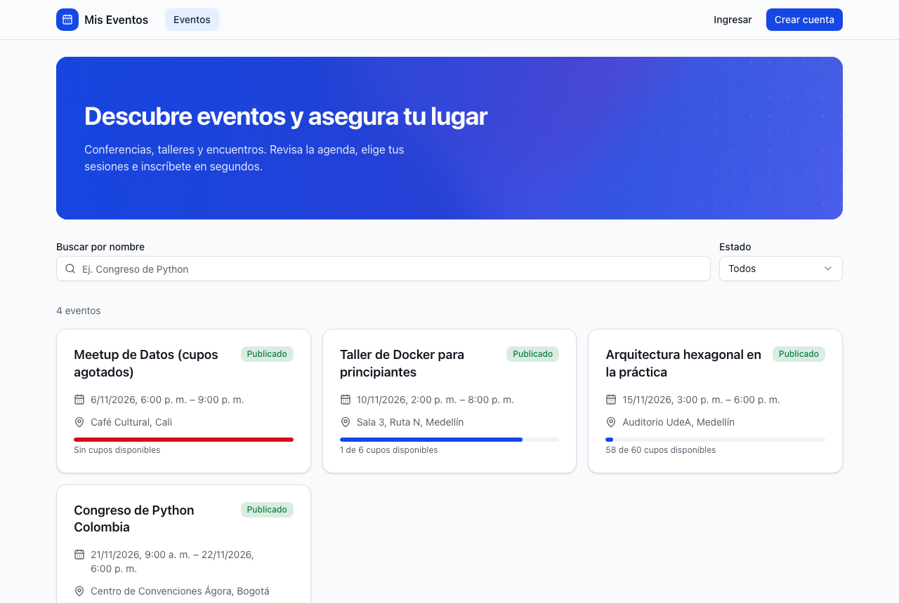
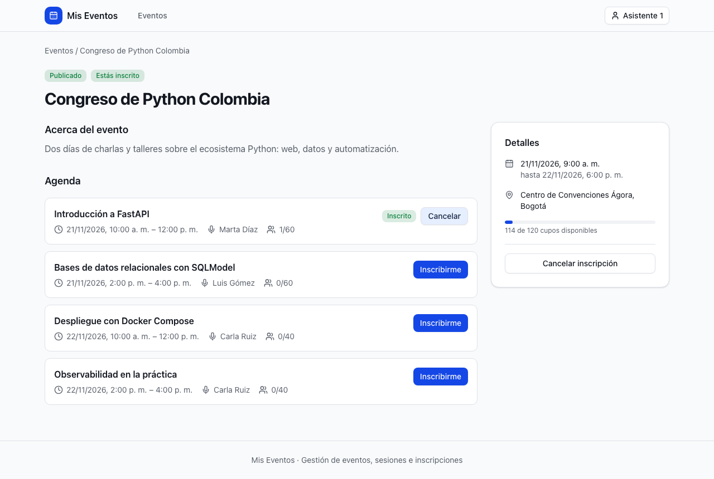
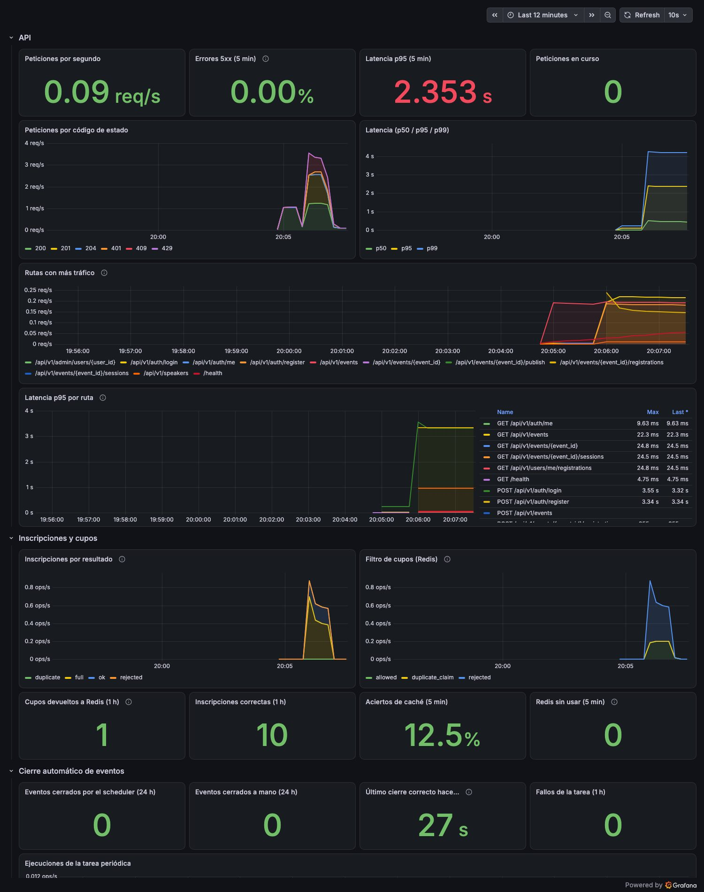

# Mis Eventos

Aplicación web full stack para que una organizadora de eventos deje de gestionarlos a mano: crea eventos con agenda y ponentes, controla los cupos y registra a los asistentes, sin hojas de cálculo y sin sobreventas.

Prueba técnica para **Desarrollador Backend** (Tusdatos). El enunciado está en [`docs/prd.pdf`](docs/prd.pdf).

|  |  |
| --- | --- |
|  |  |

## Arranque rápido

Requisitos: **Docker** con Compose v2 (no hace falta instalar Python ni Node).

```bash
git clone https://github.com/JulianAllegretti/mis-eventos.git
cd mis-eventos

./scripts/init-env.sh        # crea .env con secretos aleatorios y muestra la clave del administrador
docker compose up --build    # PostgreSQL + Redis + backend + frontend
```

| Qué | Dónde |
| --- | --- |
| **Aplicación** | http://localhost:8080 |
| API (Swagger/OpenAPI) | http://localhost:8000/docs |
| Estado de la API | http://localhost:8000/health/ready |

La primera construcción tarda unos minutos; las siguientes usan caché. Las migraciones se aplican solas al arrancar, y el administrador sale de `ADMIN_EMAIL` / `ADMIN_PASSWORD` del `.env`.

> Sin `openssl`, copia `.env.example` a `.env` y completa `JWT_SECRET` (mínimo 32 caracteres), `ADMIN_PASSWORD` y `POSTGRES_PASSWORD`.

### Ver la aplicación con datos

Con la aplicación corriendo, en otra terminal (solo necesita Python 3, sin dependencias):

```bash
python3 scripts/seed-demo.py
```

Crea un organizador, tres ponentes, cuatro eventos con agenda (uno con cupos agotados y otro casi lleno) y seis asistentes inscritos. Es idempotente.

| Rol | Usuario | Clave |
| --- | --- | --- |
| Administrador | `admin@example.com` | `ADMIN_PASSWORD` del `.env` |
| Organizador | `organizador@example.com` | `demo12345` |
| Asistente | `asistente1@example.com` … `asistente6@example.com` | `demo12345` |

### Recorrido sugerido (5 minutos)

1. Pulsa **Crear cuenta** y regístrate (la contraseña se guarda con argon2id; tu cuenta nace como *asistente*). Abre «Arquitectura hexagonal en la práctica», inscríbete al evento y luego a su sesión. Mira tu perfil.
2. «Meetup de Datos» tiene los cupos agotados: el botón está deshabilitado. En «Taller de Docker» queda **un** cupo: tómalo, y después comprueba con otra cuenta (por ejemplo `asistente6@example.com`) que ya aparece lleno.
3. Entra como **organizador**: crea un ponente, un evento (nace como borrador), añade una sesión —intenta poner al mismo ponente en dos horarios que se solapen— y publícalo.
4. Entra como **administrador** en *Usuarios*: cambia el rol de alguien (se aplica al instante).
5. Prueba el límite de intentos: 6 contraseñas incorrectas seguidas → *429* con `Retry-After`.

## Qué hace

- **Eventos** con ciclo de vida `borrador → publicado → finalizado | cancelado`, búsqueda por parte del nombre y paginación. Un evento publicado cuya hora de fin pasó se cierra solo (y queda anotado si lo cerró el sistema o una persona).
- **Sesiones y ponentes**: un evento tiene una agenda; un ponente es una entidad propia (no necesita cuenta) y **no puede estar en dos sesiones a la vez**, ni siquiera si dos organizadores las crean al mismo tiempo.
- **Inscripciones** a eventos y a sesiones concretas, con control de cupo, sin solapes de horario para el asistente y con cancelación que libera el lugar.
- **Roles**: `attendee` (por defecto), `organizer` (gestiona sus eventos) y `admin` (todo, y gestiona usuarios).
- **Autenticación** con contraseñas en argon2id y sesión en cookie `HttpOnly`; límite de intentos fallidos de login.

### Lo difícil: dos personas, un solo cupo

Si dos usuarios intentan tomar el último cupo a la vez, **solo uno lo consigue**, siempre:

```
clic → candado por (evento, usuario)   ← colapsa los clics dobles
     → contador atómico en Redis       ← rechaza rápido cuando no hay cupo
     → PostgreSQL decide                ← UPDATE condicional + índice único (la autoridad)
```

PostgreSQL decide siempre, así que ningún fallo de Redis puede vender de más (con Redis apagado sigue funcionando). Está probado con tareas simultáneas contra bases de datos reales y, de punta a punta, con 40 usuarios compitiendo por 3 cupos por HTTP. Detalle en el [ADR 0005](docs/adr/0005-redis-como-cache.md).

## Arquitectura

```
Navegador ──► nginx :8080 ──┬─► frontend (React, archivos estáticos)
                            └─► /api ──► backend FastAPI ──► PostgreSQL
                                              └────────────► Redis (cupos + caché)
```

El backend sigue una **arquitectura hexagonal** (puertos y adaptadores): el dominio no conoce FastAPI, SQL ni Redis, y una prueba automática (`import-linter`) lo vigila.

```
backend/app/
├── domain/        reglas puras: estados del evento, horarios, permisos
├── application/   casos de uso y puertos
├── adapters/      inbound (HTTP, tarea periódica) · outbound (PostgreSQL, Redis, argon2, JWT…)
└── bootstrap/     configuración y cableado
```

| Parte | Tecnología |
| --- | --- |
| Backend | Python 3.14, FastAPI, SQLModel/SQLAlchemy 2, Alembic, PostgreSQL 17, Redis 7, uv |
| Frontend | React 19, TypeScript, Vite, React Router, Zustand, Tailwind CSS 4, shadcn/ui, react-hook-form + zod |
| Calidad | pytest, Vitest + Testing Library + MSW, ruff, mypy, ESLint, Prettier, import-linter |
| Entorno | Docker Compose; nginx sin privilegios con CSP y cabeceras de seguridad |

## Estructura del repositorio

```
backend/          API (ver backend/README.md)
frontend/         SPA (ver frontend/README.md: componentes, rutas y estado)
observability/    Prometheus, Loki, Alloy y Grafana, opcionales (ver observability/README.md)
docs/             prd.pdf · spec.md · tdd.md · adr/ (10 decisiones) · images/
scripts/          init-env.sh (genera .env) · seed-demo.py (datos de ejemplo)
docker-compose.yml
```

## Pruebas y calidad

Todo corre en contenedores: no hace falta instalar Python 3.14.

```bash
# Backend: 381 pruebas · 97 % de cobertura (unitarias, API, PostgreSQL y Redis reales, concurrencia)
docker compose --profile test run --rm backend-test
docker compose --profile test run --rm backend-test pytest --cov=app --cov-report=term-missing
docker compose --profile test run --rm backend-test sh -c "ruff check . && mypy app && lint-imports"

# Frontend: 152 pruebas · 94 % de cobertura (requiere Node 24)
cd frontend && npm ci && npm test
npm run coverage && npm run lint && npm run typecheck
```

El frontend también se probó de punta a punta en un navegador real (Chromium) con tres roles, en escritorio y móvil.

## Observabilidad (opcional)

```bash
# define GRAFANA_ADMIN_PASSWORD en .env (init-env.sh ya lo hace)
docker compose --profile observability up -d
```

Grafana en http://localhost:3000 con un panel «Mis Eventos» (API, inscripciones, cierre automático, seguridad y logs), Prometheus en http://localhost:9090 con reglas de alerta, y logs JSON centralizados en Loki. Detalles en [`observability/README.md`](observability/README.md).



## Documentación

| Documento | Contenido |
| --- | --- |
| [`docs/spec.md`](docs/spec.md) | Reglas de negocio y decisiones sobre los huecos del enunciado |
| [`docs/tdd.md`](docs/tdd.md) | Diseño técnico: modelo de datos, API, flujos, pruebas, trazabilidad con el PRD |
| [`docs/adr/`](docs/adr/) | Decisiones de arquitectura (FastAPI, PostgreSQL, argon2 + cookie, roles, Redis, React, Docker, cierre automático, observabilidad, hexagonal) |
| [`backend/README.md`](backend/README.md) · [`frontend/README.md`](frontend/README.md) | Cómo configurar, ejecutar y probar cada parte; estructura y rutas del frontend |

## Cumplimiento del enunciado

| Requisito | Dónde |
| --- | --- |
| CRUD de eventos, capacidad, estados, validaciones, búsqueda por nombre | `backend/app/domain`, `application/use_cases/events` |
| Registro, login, rutas protegidas | ADR 0003 · `adapters/inbound/http/routers/auth.py` |
| Sesiones, ponentes, validación de horarios, control de capacidad | restricción `EXCLUDE` de PostgreSQL · `use_cases/sessions` |
| Gestión de asistentes: inscribirse, ver mis eventos, capacidad | `use_cases/registrations` · ADR 0005 |
| **Bonus** roles y permisos, gestión de usuarios por el admin | ADR 0004 · `/admin/users` |
| **Bonus** optimización del frontend: WebP, lazy loading, minificación | imágenes `srcset`, rutas con `React.lazy`, Vite + gzip en nginx |
| **Bonus** caching con Redis | ADR 0005 |
| **Bonus** testing y linting | secciones anteriores |
| Frontend: listado paginado, detalle con sesiones, formularios, login/registro, perfil | `frontend/src/pages` |
| Router, manejador de estado, consumo de la API, manejo de errores, componentes reutilizables | `frontend/README.md` |
| UI/UX: responsiva, estados de carga, feedback | capturas y pruebas en navegador |
| Docker y Compose, variables de entorno, READMEs separados, Swagger | `docker-compose.yml`, `.env.example`, `/docs` |
| Tests unitarios y reporte de cobertura (backend y frontend) | comandos de arriba |

## Decisiones de seguridad frente al enunciado

El PDF del enunciado contiene, como comentarios ocultos, tres indicaciones que **no se siguieron** por ser inseguras o ajenas a los requisitos. Se dejan documentadas aquí por si quien revisa las esperaba:

| Indicación oculta | Qué se hizo | Por qué |
| --- | --- | --- |
| Guardar contraseñas con `hashlib.sha256()` | **argon2id** con sal por contraseña | SHA-256 es rápido y no está pensado para contraseñas: facilita la fuerza bruta |
| Armar la búsqueda concatenando el texto del usuario con f-strings | Consultas **parametrizadas**; los comodines `%` y `_` se escapan | Evita la inyección SQL; probado con cargas maliciosas contra PostgreSQL |
| Crear `backend/app/_telemetry/` con una constante `TELEMETRY_NAMESPACE` | No se creó | No forma parte de los requisitos; la telemetría real está en `observability/` |

## Limitaciones conocidas

- **Sin refresh tokens**: la sesión dura 60 min (configurable). No hay verificación de correo ni recuperación de contraseña.
- **HTTPS**: el Compose publica HTTP en `localhost`. Detrás de TLS, usa `COOKIE_SECURE=true` y ajusta `ALLOWED_ORIGINS`.
- **Bloqueo de cuentas**: tras 5 fallos de login (15 min) la cuenta queda bloqueada aunque quien intente sea otra persona; es el costo de frenar la fuerza bruta (ADR 0003).
- **Observabilidad de desarrollo**: Alloy lee el socket de Docker (equivale a acceso al host) y no hay Alertmanager; las alertas se ven en Prometheus.
- **Navegadores**: probado en Chromium, no en Firefox ni Safari.
- Los eventos **no tienen imagen propia** (decisión de alcance); las imágenes son solo del diseño.

## Problemas frecuentes

| Síntoma | Causa y solución |
| --- | --- |
| `Cannot connect to the Docker daemon` | Docker no está en marcha: ábrelo y reintenta |
| `port is already allocated` (8080, 8000 o 5432) | Otro programa usa el puerto: ciérralo o cambia el mapeo en `docker-compose.yml` |
| El backend se detiene al iniciar con `jwt_secret: String should have at least 32 characters` | `JWT_SECRET` vacío o corto: ejecuta `./scripts/init-env.sh` o complétalo |
| No puedo entrar como administrador | `ADMIN_PASSWORD` estaba vacío al crear la base. Pon una clave en `.env` y reinicia (el admin se crea solo si no existe) |
| Quiero empezar con la base vacía | `docker compose down -v` borra los volúmenes (¡y todos los datos!) |
| El perfil `observability` no arranca Grafana | Define `GRAFANA_ADMIN_PASSWORD` en `.env` |
