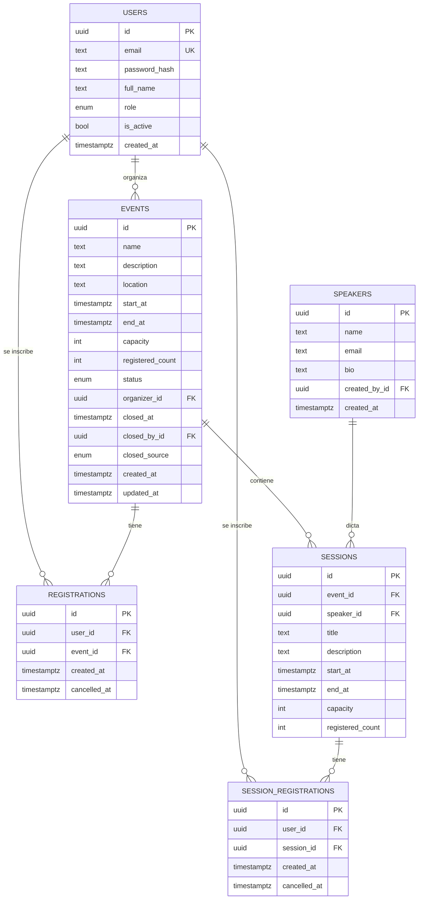
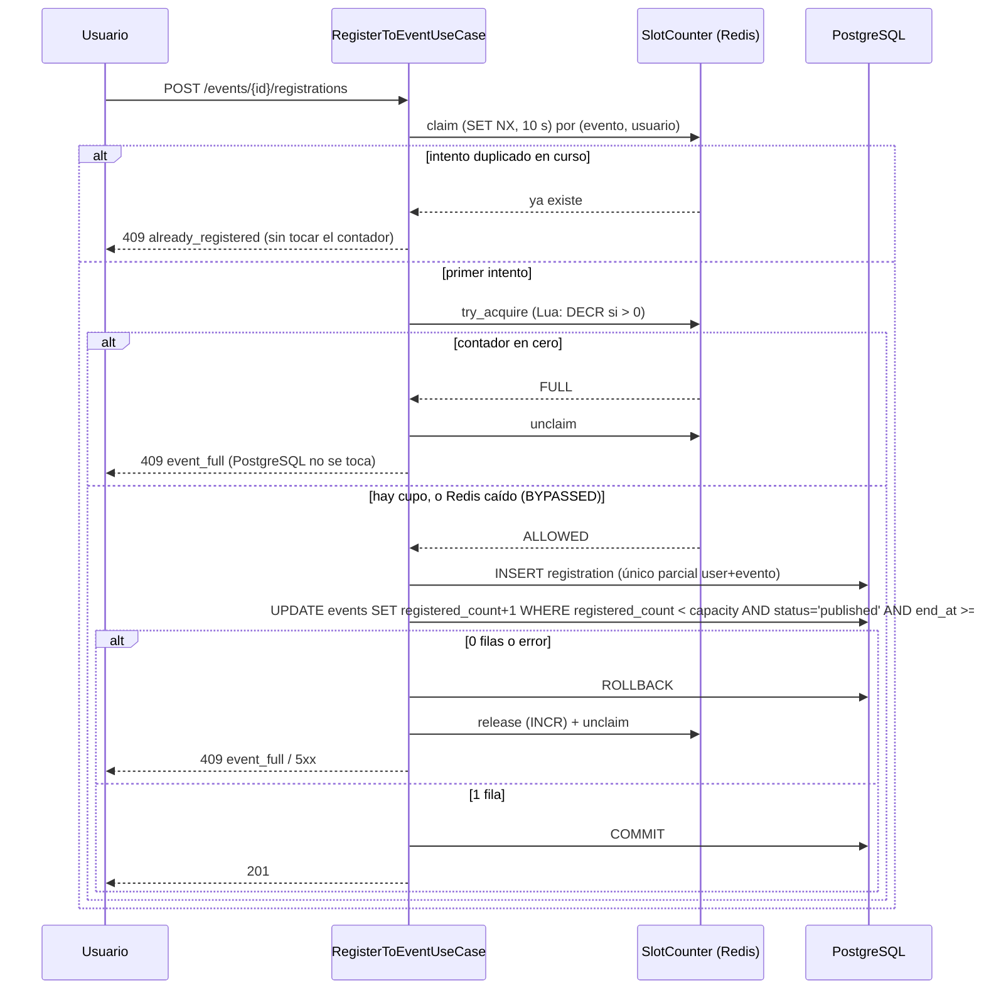

# TDD — Technical Design Document: Mis Eventos

- **Estado:** Borrador para revisión
- **Fecha:** 2026-10-31
- **Documentos relacionados:** `prd.pdf`, `spec.md` (reglas de negocio) y `adr/0001`–`adr/0010` (decisiones).

Este documento describe **cómo** se construye el sistema. Las reglas de negocio están en `spec.md`; el porqué de cada decisión, en los ADRs.

---

## 1. Visión general

Aplicación web full stack para gestionar eventos, sesiones, ponentes e inscripciones.

```
 Navegador ──► nginx (frontend + proxy /api) ──► FastAPI (backend) ──► PostgreSQL
                                                      │
                                                      └──────────────► Redis (filtro de cupos + caché)

 (perfil opcional)  backend ──logs──► Alloy ──► Loki ──► Grafana ◄── Prometheus ◄──/metrics── backend
```

| Componente | Tecnología | ADR |
|---|---|---|
| Backend | Python 3.14, FastAPI, SQLModel/SQLAlchemy 2, Alembic, uv | 0001, 0002 |
| Base de datos | PostgreSQL | 0002 |
| Auth | argon2id + JWT en cookie `HttpOnly` | 0003 |
| Autorización | Roles `attendee` / `organizer` / `admin` + propiedad | 0004 |
| Cupos y caché | Redis (filtro previo + caché de lectura) | 0005 |
| Frontend | React, TypeScript, Vite, React Router, Zustand, Axios, Tailwind CSS, shadcn/ui | 0006 |
| Entorno | Docker Compose (+ perfil `observability`) | 0007, 0009 |
| Cierre de eventos | Tarea periódica + estado efectivo al leer | 0008 |
| Arquitectura backend | Hexagonal (puertos y adaptadores) | 0010 |

---

## 2. Arquitectura del backend (hexagonal)

### 2.1 Capas y regla de dependencia

```
        ┌───────────────── adapters/inbound ─────────────────┐
        │  http (FastAPI)            jobs (cierre de eventos) │
        └───────────────┬─────────────────────────────────────┘
                        │ usa puertos INBOUND (casos de uso)
        ┌───────────────▼─────────────────────────────────────┐
        │                     application                     │
        │   use_cases · ports/inbound · ports/outbound · dto  │
        └───────────────┬─────────────────────────────────────┘
                        │ usa
        ┌───────────────▼───────────┐
        │          domain           │   (Python puro)
        └───────────────────────────┘
                        ▲ implementan puertos OUTBOUND
        ┌───────────────┴─────────────────────────────────────┐
        │                adapters/outbound                    │
        │ persistence · security · cache · system · observ.   │
        └─────────────────────────────────────────────────────┘
```

La flecha de dependencia siempre apunta hacia el dominio. `import-linter` lo verifica en CI con estos contratos:

1. `app.domain` no importa ningún otro módulo de `app` ni `fastapi`, `sqlmodel`, `sqlalchemy`, `redis`, `pydantic`.
2. `app.application` solo importa `app.domain`.
3. `app.adapters.inbound` y `app.adapters.outbound` no se importan entre sí.
4. Solo `app.bootstrap` importa de ambos.

### 2.2 Estructura de carpetas

```
backend/
├── pyproject.toml            # uv, ruff, pytest, import-linter
├── alembic.ini
├── Dockerfile
├── README.md
├── migrations/
│   └── versions/
├── app/
│   ├── main.py               # crea la app FastAPI llamando a bootstrap
│   ├── bootstrap/
│   │   ├── settings.py       # pydantic-settings: lee variables de entorno
│   │   ├── container.py      # composition root: construye adaptadores y casos de uso
│   │   └── app.py            # create_app: ensambla la app y su lifespan (seed del admin,
│   │                         # tarea de cierre, cierre de pools); los tests inyectan un contenedor falso
│   │
│   ├── domain/
│   │   ├── models/
│   │   │   ├── user.py             # User, Role
│   │   │   ├── speaker.py          # Speaker
│   │   │   ├── event.py            # Event, EventStatus, ClosedSource
│   │   │   ├── session.py          # Session
│   │   │   └── registration.py     # Registration, SessionRegistration
│   │   ├── services/
│   │   │   ├── event_lifecycle.py  # máquina de estados y transiciones válidas
│   │   │   ├── scheduling.py       # solapes, rango dentro del evento
│   │   │   └── permissions.py      # quién puede hacer qué (rol + propiedad)
│   │   └── errors.py               # NotFound, Conflict, Forbidden, ValidationFailed, ...
│   │
│   ├── application/
│   │   ├── ports/
│   │   │   ├── inbound/            # qué ofrece la aplicación (casos de uso)
│   │   │   │   ├── auth.py         #   RegisterUser, LoginUser, GetCurrentUser
│   │   │   │   ├── events.py       #   CreateEvent, UpdateEvent, SearchEvents, ...
│   │   │   │   ├── speakers.py
│   │   │   │   ├── sessions.py
│   │   │   │   ├── registrations.py#   RegisterToEvent, CancelRegistration, ...
│   │   │   │   └── admin.py        #   ListUsers, ChangeUserRole, SetUserActive
│   │   │   └── outbound/           # qué necesita la aplicación del exterior
│   │   │       ├── repositories.py #   UserRepository, EventRepository, SpeakerRepository, ...
│   │   │       ├── unit_of_work.py #   UnitOfWork
│   │   │       ├── slot_counter.py #   SlotCounter (filtro de cupos)
│   │   │       ├── cache.py        #   Cache
│   │   │       ├── security.py     #   PasswordHasher, TokenService
│   │   │       ├── clock.py        #   Clock
│   │   │       └── metrics.py      #   Metrics
│   │   ├── dto/
│   │   │   ├── commands.py         # CreateEventCommand, RegisterToEventCommand, ...
│   │   │   ├── queries.py          # SearchEventsQuery(q, page, page_size, ...)
│   │   │   └── read_models.py      # Page[T], EventSummary, EventDetail, ...
│   │   └── use_cases/
│   │       ├── auth/
│   │       ├── events/             # incluye finish_expired_events.py
│   │       ├── speakers/
│   │       ├── sessions/
│   │       ├── registrations/
│   │       └── admin/
│   │
│   └── adapters/
│       ├── inbound/
│       │   ├── http/
│       │   │   ├── app_factory.py  # monta routers, middlewares y manejadores de error
│       │   │   ├── routers/        # auth, events, sessions, speakers, registrations, admin, health
│       │   │   ├── schemas/        # modelos Pydantic de petición/respuesta (solo API)
│       │   │   ├── mappers/        # schema ↔ command/query; entidad/read model → schema
│       │   │   ├── dependencies.py # usuario actual (cookie), require_role, casos de uso
│       │   │   ├── cookies.py      # set/clear de la cookie de sesión
│       │   │   ├── middleware/     # request_id, origin_check (CSRF), access_log
│       │   │   └── error_handlers.py # errores de dominio → códigos HTTP
│       │   └── jobs/
│       │       └── finish_events_job.py  # bucle periódico que llama al caso de uso
│       └── outbound/
│           ├── persistence/
│           │   ├── database.py     # engine y sesión async
│           │   ├── tables.py       # modelos SQLModel (table=True), SOLO aquí
│           │   ├── mappers.py      # tabla ↔ entidad de dominio
│           │   ├── repositories/   # una clase por repositorio
│           │   └── unit_of_work.py # SqlUnitOfWork
│           ├── security/
│           │   ├── argon2_hasher.py
│           │   └── jwt_token_service.py
│           ├── cache/
│           │   ├── redis_cache.py
│           │   └── redis_slot_counter.py   # scripts Lua
│           ├── system/
│           │   └── system_clock.py
│           └── observability/
│               ├── logging.py      # structlog JSON
│               └── prometheus_metrics.py
│
└── tests/
    ├── unit/
    │   ├── domain/             # sin I/O
    │   ├── use_cases/          # con fakes en memoria
    │   └── fakes/              # repositorios, UoW, reloj, contador en memoria
    ├── integration/
    │   ├── persistence/        # repos contra PostgreSQL real
    │   ├── cache/              # Redis real
    │   └── concurrency/        # carreras de inscripción
    └── api/                    # TestClient con la app completa
```

### 2.3 Mappers: qué convierte qué

| Frontera | Mapper | Ubicación | Dirección |
|---|---|---|---|
| HTTP → aplicación | `schemas → commands/queries` | `adapters/inbound/http/mappers/` | `CreateEventRequest → CreateEventCommand` |
| aplicación → HTTP | `entidades/read models → schemas` | `adapters/inbound/http/mappers/` | `Event → EventResponse` (nunca expone `password_hash` ni campos internos) |
| aplicación ↔ BD | `tablas ↔ entidades` | `adapters/outbound/persistence/mappers.py` | `EventTable ↔ Event` |

Reglas:
- Los routers solo reciben schemas, llaman a un puerto inbound y devuelven schemas. No contienen reglas de negocio.
- Los casos de uso solo manejan comandos, queries, entidades y read models.
- Los repositorios devuelven entidades de dominio, jamás objetos `SQLModel`.

### 2.4 Ejemplo: puertos y caso de uso (inscripción a un evento)

```python
# application/ports/inbound/registrations.py
class RegisterToEvent(Protocol):
    async def execute(self, cmd: RegisterToEventCommand) -> Registration: ...

# application/ports/outbound/slot_counter.py
class SlotCounter(Protocol):
    async def try_acquire(self, event_id: UUID) -> SlotResult: ...   # ALLOWED | FULL | BYPASSED
    async def release(self, event_id: UUID) -> None: ...

# application/ports/outbound/repositories.py
class EventRepository(Protocol):
    async def get(self, event_id: UUID) -> Event | None: ...
    async def try_increment_registered(self, event_id: UUID) -> bool: ...   # UPDATE condicional atómico
    ...
```

```python
# application/use_cases/registrations/register_to_event.py
class RegisterToEventUseCase:                      # implementa RegisterToEvent
    def __init__(self, uow: UnitOfWork, slots: SlotCounter, clock: Clock, metrics: Metrics): ...

    async def execute(self, cmd):
        result = await self.slots.try_acquire(cmd.event_id)
        if result is SlotResult.FULL:
            raise EventFull()
        try:
            async with self.uow:
                event = await self.uow.events.get(cmd.event_id)
                ensure_open_for_registration(event, self.clock.now())   # regla de dominio
                if not await self.uow.events.try_increment_registered(event.id):
                    raise EventFull()
                registration = await self.uow.registrations.add(Registration.new(cmd.user_id, event.id))
                await self.uow.commit()
            return registration
        except Exception:
            await self.slots.release(cmd.event_id)    # compensación
            raise
```

> Nota de implementación: los casos de uso reciben una fábrica (`uow_factory: UnitOfWorkFactory`) y abren una transacción por ejecución con `async with self._uow_factory() as uow:`. El ejemplo anterior abrevia escribiendo `self.uow`. Los adaptadores HTTP dependen de un `Protocol` (`AppContainer`) que el `Container` del bootstrap cumple, de modo que `adapters` nunca importa `bootstrap`.

### 2.5 Cableado (composition root)

`bootstrap/container.py` es el único lugar que instancia adaptadores y los pasa a los casos de uso. Los routers obtienen los casos de uso con `Depends` desde `dependencies.py`, que lee el contenedor. En los tests, `app.dependency_overrides` o un contenedor de pruebas sustituyen los adaptadores por fakes.

---

## 3. Modelo de datos

### 3.1 Diagrama



### 3.2 Restricciones e índices

| Tabla | Restricción / índice | Propósito |
|---|---|---|
| `users` | `UNIQUE (email)` con email en minúsculas | Un solo usuario por correo |
| `events` | `CHECK (capacity >= 1)`, `CHECK (end_at > start_at)`, `CHECK (registered_count BETWEEN 0 AND capacity)` | Integridad; ver ADR 0005 |
| `events` | `CHECK` de cierre: `closed_at`, `closed_source` presentes si y solo si `status IN ('finished','cancelled')`; `closed_by_id` nulo si y solo si `closed_source = 'scheduler'` | Trazabilidad (ADR 0008) |
| `events` | Índice `GIN (name gin_trgm_ops)` (extensión `pg_trgm`) | Búsqueda `ILIKE '%texto%'` |
| `events` | Índice `(status, start_at)` | Listado paginado ordenado |
| `sessions` | `CHECK (end_at > start_at)`, `CHECK (capacity >= 1)`, `CHECK (registered_count BETWEEN 0 AND capacity)` | Integridad |
| `sessions` | `EXCLUDE USING gist (speaker_id WITH =, tstzrange(start_at, end_at) WITH &&)` (extensión `btree_gist`) | Un ponente no puede tener sesiones solapadas, ni siquiera bajo concurrencia |
| `registrations` | Único parcial `(user_id, event_id) WHERE cancelled_at IS NULL` | Una inscripción activa por usuario y evento |
| `session_registrations` | Único parcial `(user_id, session_id) WHERE cancelled_at IS NULL` | Idem para sesiones |

Reglas que cruzan tablas y se validan en la aplicación (dentro de la transacción):
- La sesión cae dentro del rango del evento y su capacidad es ≤ la del evento.
- Para inscribirse a una sesión hay una inscripción activa al evento.
- Un usuario no se inscribe a sesiones solapadas; se serializa por usuario con `pg_advisory_xact_lock(hashtext(user_id))` para cubrir el doble clic concurrente.
- Cancelar una inscripción a un evento cancela también sus inscripciones a sesiones y libera esos cupos.

Las claves foráneas usan `ON DELETE RESTRICT`, salvo `sessions.event_id` y `session_registrations.session_id`, que usan `CASCADE`: borrar un evento (solo posible sin historial de inscripciones) se lleva sus sesiones. No se borran eventos con inscripciones (activas o canceladas; se cancelan) ni ponentes con sesiones (el caso de uso lo comprueba y la clave foránea lo garantiza).

---

## 4. API REST

Prefijo `/api/v1`. Documentación en `/docs` (Swagger) y `/openapi.json`. Esquema de seguridad declarado como `apiKey` en cookie `access_token`. Errores con cuerpo `{ "code": "...", "message": "...", "details": [...] }`.

### 4.1 Endpoints

| Método y ruta | Acceso | Descripción |
|---|---|---|
| `POST /auth/register` | Público | Crea un usuario `attendee` |
| `POST /auth/login` | Público | Valida credenciales y fija la cookie |
| `POST /auth/logout` | Autenticado | Borra la cookie |
| `GET /auth/me` | Autenticado | Usuario de la sesión actual |
| `GET /events` | Público | Lista paginada. Parámetros: `q` (nombre parcial), `page`, `page_size` (≤ 50), `status`, `scope=mine` (borradores propios, requiere sesión) |
| `GET /events/{id}` | Público (borrador: dueño/admin) | Detalle del evento; su agenda con ponentes está en `GET /events/{id}/sessions` |
| `POST /events` | `organizer`, `admin` | Crea un evento en `draft` |
| `PATCH /events/{id}` | Dueño o `admin` | Edita datos |
| `DELETE /events/{id}` | Dueño o `admin` | Borra un evento sin inscripciones |
| `POST /events/{id}/publish` | Dueño o `admin` | `draft → published` |
| `POST /events/{id}/finish` | Dueño o `admin` | `published → finished` (manual) |
| `POST /events/{id}/cancel` | Dueño o `admin` | `draft/published → cancelled` |
| `POST /events/{id}/registrations` | Autenticado | Se inscribe al evento |
| `DELETE /events/{id}/registrations/me` | Autenticado | Cancela su inscripción |
| `GET /events/{id}/registrations` | Dueño o `admin` | Lista de asistentes |
| `GET /users/me/registrations` | Autenticado | Eventos (y sesiones) en los que está inscrito |
| `GET /events/{id}/sessions` | Público | Sesiones del evento |
| `POST /events/{id}/sessions` | Dueño o `admin` | Crea una sesión |
| `PATCH /sessions/{id}` | Dueño del evento o `admin` | Edita una sesión |
| `DELETE /sessions/{id}` | Dueño del evento o `admin` | Borra una sesión sin inscritos |
| `POST /sessions/{id}/registrations` | Autenticado | Se inscribe a la sesión |
| `DELETE /sessions/{id}/registrations/me` | Autenticado | Cancela su inscripción a la sesión |
| `GET /speakers`, `GET /speakers/{id}` | Autenticado `organizer`, `admin` | Consulta |
| `POST /speakers`, `PATCH /speakers/{id}`, `DELETE /speakers/{id}` | `organizer`, `admin` | Gestión (no se borra con sesiones asociadas) |
| `GET /admin/users` | `admin` | Lista paginada de usuarios |
| `PATCH /admin/users/{id}` | `admin` | Cambia rol o `is_active` |
| `GET /health`, `GET /health/ready` | Público | Liveness / readiness |
| `GET /metrics` | Solo red interna | Métricas Prometheus |

### 4.2 Mapeo de errores de dominio a HTTP

| Error de dominio | HTTP |
|---|---|
| `NotAuthenticated` | 401 |
| `Forbidden` | 403 |
| `NotFound` | 404 |
| `EventFull`, `AlreadyRegistered`, `InvalidTransition`, `ScheduleConflict` | 409 |
| `ValidationFailed` | 422 |

---

## 5. Flujos clave

### 5.1 Login y sesión (ADR 0003)

1. `POST /auth/login` → caso de uso `LoginUser`: busca por email, verifica con `PasswordHasher`, emite el JWT con `TokenService`.
2. El adaptador HTTP fija la cookie `access_token` (`HttpOnly`, `Secure` según `COOKIE_SECURE`, `SameSite=Lax`). El cuerpo devuelve solo el usuario.
3. En cada petición, `dependencies.py` lee la cookie, valida el JWT y **recarga el usuario de la BD** (rol e `is_active` vigentes).
4. El middleware `origin_check` rechaza con 403 los métodos que modifican datos si `Origin`/`Referer` no está en `ALLOWED_ORIGINS`.

### 5.2 Inscripción a un evento con control de concurrencia (ADR 0005)



Garantías: **PostgreSQL decide siempre** (actualización condicional + restricción única), por lo que ningún fallo de Redis puede causar sobreventa. El `claim` evita un subventa: sin él, los clics dobles retienen cupo en Redis mientras están en vuelo y pueden provocar `event_full` a usuarios legítimos aunque quede lugar (se observó en pruebas con 25 usuarios × 2 clics sobre 4 cupos: se vendían 3). Cancelar una inscripción libera el cupo y el candado.

### 5.3 Cierre automático (ADR 0008)

`MaintenanceJob` (`adapters/inbound/jobs/maintenance_job.py`, iniciado en el `lifespan`) ejecuta cada `FINISH_JOB_INTERVAL_SECONDS` (0 lo desactiva) el caso de uso `FinishExpiredEvents`, que toma `pg_try_advisory_xact_lock` dentro de la transacción (así varios workers no duplican el trabajo), ejecuta el `UPDATE ... RETURNING id` con `closed_source='scheduler'`, invalida la caché y descarta los contadores de Redis. En el mismo ciclo corre `ReconcileSlots`, que corrige desvíos de los contadores existentes tomando a PostgreSQL como verdad. Un fallo de cualquiera se registra y se reintenta en el ciclo siguiente. Mientras no corra, el dominio considera `finished` a un evento publicado con `end_at < now()` (estado efectivo).

### 5.4 Creación de sesión

El caso de uso carga el evento, verifica permisos (`permissions.py`), valida con `scheduling.py` (rango, capacidad, fin > inicio) y deja que la restricción `EXCLUDE` rechace solapes del ponente (una comprobación previa da el mensaje amable; la restricción cubre la carrera entre dos creaciones simultáneas). La excepción de integridad que lanza el adaptador se traduce a `ScheduleConflict` (409). Una sesión con inscritos no puede cambiar de horario ni de ponente, y editar un evento no puede dejar sesiones fuera de su nuevo horario o con más capacidad que él.

### 5.5 Inscripción a una sesión

Exige una inscripción activa al evento, serializa por usuario con `pg_advisory_xact_lock` (dos clics simultáneos a sesiones solapadas no pasan ambos), valida que no haya solapes con sus otras sesiones y toma el cupo con una actualización condicional sobre `sessions.registered_count`. Cancelar la inscripción al evento cancela también las de sus sesiones.

---

## 6. Frontend

### 6.1 Estructura

```
frontend/
├── package.json, vite.config.ts, tsconfig.json, eslint.config.js
├── components.json          # configuración de la CLI de shadcn/ui
├── Dockerfile, nginx.conf, README.md
├── public/                  # assets estáticos del diseño (WebP)
└── src/
    ├── main.tsx, App.tsx
    ├── routes/              # definición de rutas (lazy) y guards
    │   ├── index.tsx
    │   ├── ProtectedRoute.tsx   # exige sesión y, opcionalmente, rol
    │   └── RoleRoute.tsx
    ├── pages/
    │   ├── EventListPage.tsx
    │   ├── EventDetailPage.tsx
    │   ├── EventFormPage.tsx          # crear / editar
    │   ├── LoginPage.tsx
    │   ├── RegisterPage.tsx
    │   ├── ProfilePage.tsx            # mis inscripciones
    │   ├── SpeakersPage.tsx           # organizer/admin
    │   ├── AdminUsersPage.tsx         # admin
    │   └── NotFoundPage.tsx
    ├── features/
    │   ├── auth/            # authStore, authApi, hooks
    │   ├── events/          # eventsStore, eventsApi, componentes de evento
    │   ├── sessions/
    │   ├── registrations/
    │   └── speakers/
    ├── components/
    │   ├── ui/              # primitivas de shadcn/ui (Button, Input, Select, Dialog, Form, Table,
    │   │                    # Pagination, Skeleton, Badge, Sonner...), generadas con la CLI
    │   └── ...              # reutilizables propios sobre ui/: EventCard, SessionList,
    │                        # SearchBar, FormularioEvento, Spinner, Navbar, PageLayout
    ├── api/
    │   ├── client.ts        # Axios (withCredentials, interceptor de errores)
    │   └── types.ts         # tipos de la API
    ├── lib/utils.ts         # helper cn() (clsx + tailwind-merge)
    ├── hooks/, utils/, styles/globals.css   # directivas de Tailwind y variables del tema
    └── test/                # setup de Vitest, handlers de MSW
```

> **Nota de implementación:** la estructura final del frontend, las rutas, el estado y las decisiones se documentan en `frontend/README.md`, que es la referencia vigente. Diferencias respecto al borrador de arriba: se añadieron `stores/registrationsStore.ts` (mis inscripciones), `hooks/useAsyncData.ts` y `usePageState.ts` (carga de datos sin `setState` en efectos), los módulos de `api/` son uno por recurso, y las páginas de formulario usan `react-hook-form` + `zod` con los avisos de `sonner` (esquina inferior derecha para no tapar la navegación).

### 6.2 Rutas

| Ruta | Página | Acceso |
|---|---|---|
| `/` | Listado de eventos (búsqueda + paginación) | Público |
| `/events/:id` | Detalle con sesiones | Público |
| `/events/new` | Crear evento | `organizer`, `admin` |
| `/events/:id/edit` | Editar evento | Dueño o `admin` |
| `/login`, `/register` | Autenticación | Solo sin sesión |
| `/profile` | Mis inscripciones | Autenticado |
| `/speakers` | Gestión de ponentes | `organizer`, `admin` |
| `/admin/users` | Gestión de usuarios | `admin` |

Todas las páginas se cargan con `React.lazy` + `Suspense` (code splitting por ruta).

### 6.3 Estado (Zustand)

- `authStore`: `user`, `status` (`unknown | authenticated | anonymous`), `login`, `logout`, `loadSession` (llama a `GET /auth/me` al iniciar). No almacena el token.
- `eventsStore`: `items`, `page`, `pageSize`, `total`, `query`, `current`, `loading`, `error`, con acciones de búsqueda, paginación y carga del detalle.

### 6.4 Interacción con el backend y UX

- Axios con `withCredentials: true`; el interceptor convierte errores a un formato único. Un 401 limpia `authStore` y redirige a `/login`.
- Estados de carga con `Skeleton`/`Spinner`, botones deshabilitados durante peticiones, notificaciones con `sonner` para éxito y error, y mensajes de validación por campo (react-hook-form + zod).
- Diseño responsivo mobile-first con los breakpoints de Tailwind (rejilla de tarjetas que pasa de 1 a 2 y 3 columnas, navegación colapsable, tablas con scroll horizontal o vista en tarjetas en móvil). Accesibilidad de base aportada por Radix (foco, teclado, ARIA) y revisión de contraste en el tema.
- Los tests de frontend incluyen en su setup los polyfills de jsdom que requiere Radix.
- Rendimiento: lazy loading por ruta, imágenes del diseño en WebP con `srcset`, minificación y división de código de Vite, debounce en la búsqueda.

---

## 7. Seguridad (resumen)

| Riesgo | Mitigación |
|---|---|
| Robo de credenciales por hash débil | argon2id (rechazo de la sugerencia de SHA-256 del PRD, ADR 0003) |
| Inyección SQL | Consultas parametrizadas; `%` y `_` escapados en la búsqueda (rechazo de la concatenación con f-strings sugerida en el PRD, ADR 0002) |
| XSS → robo de sesión | Cookie `HttpOnly`; sin `dangerouslySetInnerHTML`; CSP en nginx |
| CSRF | `SameSite=Lax` + verificación de `Origin` |
| Escalada de privilegios | Rol recargado desde la BD; comprobación de rol y propiedad en `permissions.py`; registro público solo crea `attendee` |
| Enumeración de usuarios | Mensajes de login genéricos |
| Fuerza bruta | Límite de intentos de login por IP y por email (contador en Redis, p. ej. 5 por minuto) |
| Secretos | Solo variables de entorno; `.env` fuera de Git |
| Fugas en logs | Sin contraseñas, cookies, tokens ni emails; solo `user_id` |
| Contenedores | Imágenes multi-stage, usuario no root |

---

## 8. Configuración y despliegue

### 8.1 Servicios de Compose

`db` (PostgreSQL con healthcheck), `redis` (con healthcheck), `backend` (ejecuta `alembic upgrade head` y luego Uvicorn), `frontend` (nginx que sirve el build y hace proxy de `/api`). Perfil `observability`: `loki`, `alloy`, `prometheus`, `grafana`.

### 8.2 Variables de entorno (`.env.example`)

| Variable | Uso |
|---|---|
| `DATABASE_URL` | Conexión a PostgreSQL |
| `REDIS_URL` | Conexión a Redis |
| `JWT_SECRET`, `JWT_EXPIRE_MINUTES` | Firma y expiración del token |
| `COOKIE_SECURE`, `ALLOWED_ORIGINS` | Cookie y verificación de origen |
| `ADMIN_EMAIL`, `ADMIN_PASSWORD` | Seed del primer admin |
| `CACHE_TTL_SECONDS` | TTL de la caché (60) |
| `FINISH_JOB_INTERVAL_SECONDS` | Intervalo de la tarea de cierre (60) |
| `LOG_LEVEL` | Nivel de logs |
| `GRAFANA_ADMIN_USER`, `GRAFANA_ADMIN_PASSWORD` | Solo perfil `observability` |

Los READMEs de backend y frontend explican cómo configurar, ejecutar y probar cada parte, con y sin Docker.

---

## 9. Estrategia de pruebas

| Nivel | Qué cubre | Herramientas | Infraestructura |
|---|---|---|---|
| Unitarias de dominio | Estados, solapes, permisos | pytest | Ninguna |
| Unitarias de casos de uso | Flujos con repositorios, UoW, reloj y contador falsos | pytest + `tests/unit/fakes` | Ninguna |
| Integración de adaptadores | Repositorios y restricciones (`CHECK`, `EXCLUDE`, únicos), mappers, Redis, hasher, JWT | pytest + PostgreSQL y Redis reales (Compose o testcontainers) | PostgreSQL, Redis |
| Concurrencia | N inscripciones simultáneas a 1 cupo → 1 éxito y N-1 respuestas 409, con Redis activo y apagado; solape simultáneo de sesiones de un ponente; doble clic del mismo usuario | pytest + `asyncio.gather` | PostgreSQL, Redis |
| API | Contratos HTTP, cookie, CSRF, códigos de error, RBAC | `TestClient`/httpx | PostgreSQL, Redis |
| Arquitectura | Reglas de dependencia | `import-linter` | Ninguna |
| Frontend | Componentes, rutas protegidas, stores, formularios, manejo de errores | Vitest + Testing Library + MSW | Ninguna |

- **Cobertura:** objetivo ≥ 80 % en backend (`pytest-cov`) y frontend (`vitest --coverage`), con reporte HTML en cada README.
- **Calidad:** `ruff` (lint y formato) y `mypy` en backend; ESLint, Prettier y `tsc --noEmit` en frontend.
- **CI local:** un único comando por parte (`make test` o scripts de `uv`/`npm`) que ejecuta lint, arquitectura y pruebas.

---

## 10. Plan de trabajo (5 días)

| Día | Backend | Frontend / Entorno |
|---|---|---|
| 1 | Estructura hexagonal, `bootstrap`, `settings`, migración inicial, dominio base, caso de uso `auth` completo como plantilla, `import-linter` | Docker Compose (db, redis, backend), CI de lint/test |
| 2 | Eventos (CRUD, búsqueda, transiciones), ponentes, permisos por rol, admin de usuarios | Proyecto Vite, cliente API, `authStore`, login/registro |
| 3 | Sesiones (validaciones, `EXCLUDE`), inscripciones a eventos y sesiones, Redis (filtro + caché), tarea de cierre, tests de concurrencia | Listado, detalle y formulario de eventos |
| 4 | Observabilidad (logs, `/metrics`, perfil Grafana), límite de login, ajustes de errores | Perfil, ponentes, admin, UX (carga, errores), responsivo, lazy loading |
| 5 | Cobertura, pruebas de API, README, Swagger | Tests de frontend, README, estructura documentada, revisión final y entrega |

**Riesgos del plazo:** la arquitectura hexagonal y las inscripciones a sesiones son lo más costoso. Si el tiempo aprieta, se recorta primero el stack de Grafana, luego el límite de intentos de login, y por último la caché de lectura. El filtro de cupos de Redis no se recorta: PostgreSQL ya garantiza la corrección sin él.

---

## 11. Trazabilidad PRD → diseño

| Requisito del PRD | Dónde se cubre |
|---|---|
| CRUD de eventos, capacidad, estados, validaciones | spec 3.2; TDD 4, 5.3; ADR 0008 |
| Búsqueda por nombre | TDD 3.2 (índice trigram), 4.1; ADR 0002 |
| Registro, login, rutas protegidas | TDD 5.1; ADR 0003 |
| Sesiones, ponentes, horarios, capacidad | spec 3.3, 3.4; TDD 3.2, 5.4 |
| Registro a eventos, ver mis eventos, controlar capacidad | TDD 4.1, 5.2; ADR 0005 |
| Roles y permisos (bonus) | ADR 0004; TDD 4.1, 7 |
| Frontend: listado paginado, detalle, formularios, login/registro | TDD 6.1, 6.2 |
| Routing | TDD 6.2 |
| Manejador de estado | TDD 6.3; ADR 0006 |
| Consumo de la API y manejo de errores | TDD 6.4 |
| Componentes reutilizables | TDD 6.1 (`components/`) |
| Lazy loading, WebP, minificación (bonus) | TDD 6.4; ADR 0006 |
| Caching con Redis (bonus) | ADR 0005 |
| Testing y linting (bonus) | TDD 9 |
| UI/UX: responsivo, loading, feedback | TDD 6.4 |
| Python 3.14, FastAPI, SQLModel, PostgreSQL, uv, Alembic, pytest, Swagger | ADR 0001, 0002; TDD 2.2, 4 |
| Docker y Compose, variables de entorno | ADR 0007; TDD 8 |
| READMEs, documentación de API y de frontend, cobertura | TDD 6.1, 8.2, 9 |

**Directrices del PRD no adoptadas** (comentarios ocultos en el documento): hash con `hashlib.sha256()` (ADR 0003), concatenación de la consulta con f-strings (ADR 0002) y carpeta `app/_telemetry` con `TELEMETRY_NAMESPACE`, que no forma parte de los requisitos; la telemetría real está en `adapters/outbound/observability` (ADR 0009).

---

## 12. Preguntas abiertas

Ninguna por ahora. Pendientes de confirmar solo las suposiciones **[S]** de `spec.md` que no se hayan cuestionado (estados del evento, cancelación de inscripciones, sin refresh token).
